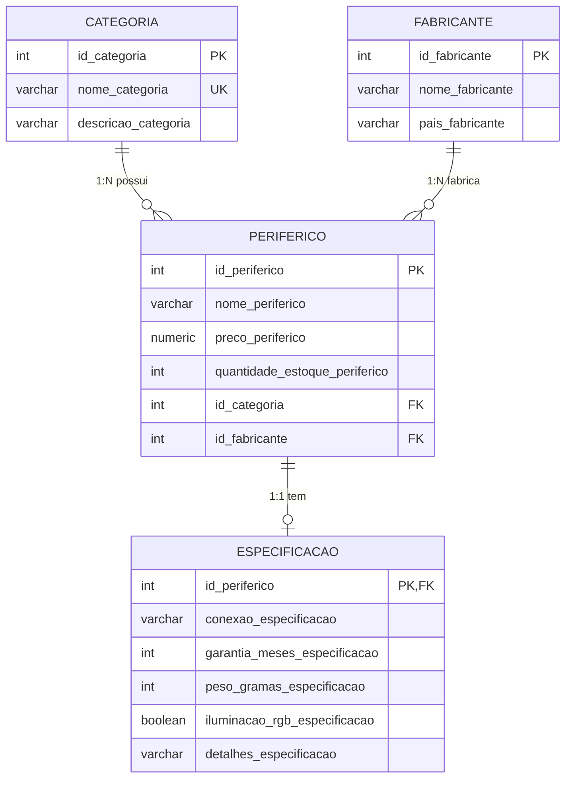

# 🎮 Gearhub V2 - Loja de Periféricos

Aplicação web **Cliente/Servidor** no padrão **MVC**, com **Node.js + Express** no servidor, **PostgreSQL** como banco e **HTML/CSS/JavaScript** puro no cliente.
Projeto de DW1 - 3º Bimestre 2026, evolução do modelo *CandyShop* (loja de doces) para uma loja de periféricos.

- **Aluno:** Lucas Rafael (Bigas)
- **Turma:** M32
- **Ano:** 2026

---

## 📌 Funcionalidades

| Página | Caminho | O que faz |
|---|---|---|
| Início | `frontend/menu/menu.html` | Menu com acesso a todos os módulos e resumo da loja (totais vindos do banco) |
| Catálogo | `frontend/catalogo/catalogo.html` | Vitrine com fotos, busca por texto, filtro por categoria e ficha técnica (1:1) |
| Periféricos | `frontend/periferico/periferico.html` | CRUD completo **com upload de imagem** |
| Categorias | `frontend/categoria/categoria.html` | CRUD completo |
| Fabricantes | `frontend/fabricante/fabricante.html` | CRUD completo |
| Especificações | `frontend/especificacao/especificacao.html` | CRUD completo da relação 1:1 |

Todas as páginas usam as tags semânticas `<header>`, `<nav>`, `<main>`, `<section>`, `<aside>` e `<footer>`, um único CSS externo (`frontend/css/estilo.css`), menu de navegação entre as rotas e rodapé com nome, turma e ano.

---

## 🗄️ Modelagem do banco de dados



| Requisito do enunciado | Tabela(s) |
|---|---|
| Tabela independente | `categoria` e `fabricante` |
| Relacionamento **1:N** | `categoria` → `periferico` e `fabricante` → `periferico` (FKs `id_categoria` e `id_fabricante`) |
| Relacionamento **1:1** | `periferico` → `especificacao` (a chave primária de `especificacao` é também FK para `periferico`) |

O arquivo **`documentacao/gearhub.sql`** contém os `CREATE TABLE` (com chaves primárias, estrangeiras e `CHECK`) e os `INSERT INTO` (10 categorias, 10 fabricantes, 12 periféricos e 12 especificações).

Regras de integridade:
- Não é possível excluir categoria/fabricante que possua periféricos (erro `23503` tratado no controller).
- Excluir um periférico exclui também a sua especificação (`ON DELETE CASCADE`).
- Preço, estoque, garantia e peso não aceitam valores negativos (`CHECK`).

---

## 🧱 Arquitetura (MVC)

```
GearHub_3bim_Gearhub_V2
├── backend
│   ├── controllers        # Lógica de negócio (Controller) e acesso ao banco (Model via SQL)
│   │   ├── categoriaController.js
│   │   ├── fabricanteController.js
│   │   ├── perifericoController.js
│   │   └── especificacaoController.js
│   ├── routes             # Mapeamento dos endpoints (Router)
│   │   ├── categoriaRoutes.js
│   │   ├── fabricanteRoutes.js
│   │   ├── perifericoRoutes.js
│   │   └── especificacaoRoutes.js
│   ├── database.js        # Conexão com o PostgreSQL via variáveis do .env
│   ├── server.js          # Inicializa o Express e registra as rotas
│   ├── .env               # Credenciais (NÃO vai para o GitHub)
│   └── .env.example       # Modelo do .env
├── frontend               # View (HTML + CSS + JS)
│   ├── css/estilo.css
│   ├── menu/  catalogo/  periferico/  categoria/  fabricante/  especificacao/
├── imagens                # Fotos dos periféricos (<id>.png) + silhueta.png
├── documentacao
│   └── gearhub.sql        # DDL + carga inicial
├── index.html             # Redireciona para o menu
├── package.json
└── README.md
```

### Fluxo de requisição/resposta (exemplo: cadastrar um periférico)

1. O usuário preenche o formulário em `periferico.html` e clica em **Salvar**.
2. `periferico.js` monta um JSON e faz `fetch` com `POST http://localhost:3001/periferico`.
3. `server.js` encaminha `/periferico` para `perifericoRoutes.js`, que liga o `POST /` à função `criarPeriferico`.
4. `perifericoController.js` valida os dados e executa o `INSERT` no PostgreSQL por meio de `database.js`.
5. O controller responde com JSON (`{ sucesso: true, mensagem, periferico }`) e o front-end atualiza a tabela e envia a imagem (`POST /periferico/upload/:id`), que o **Multer** recebe e o **Sharp** converte para `imagens/<id>.png`.

### Endpoints

Cada CRUD segue o mesmo padrão (`/categoria`, `/fabricante`, `/periferico`, `/especificacao`):

| Método | Rota | Ação |
|---|---|---|
| GET | `/<recurso>/listar` | Lista todos os registros |
| GET | `/<recurso>/:id` | Busca um registro pela chave primária |
| POST | `/<recurso>` | Insere |
| PUT | `/<recurso>/:id` | Altera |
| DELETE | `/<recurso>/:id` | Exclui |
| POST | `/periferico/upload/:id` | Envia a imagem do periférico |

---

## ▶️ Como executar

**Pré-requisitos:** Node.js 18+ e PostgreSQL instalados.

1. **Clone o repositório e instale as dependências**
   ```bash
   git clone <link-do-repositorio>
   cd GearHub_3bim_Gearhub_V2
   npm install
   ```

2. **Crie o banco de dados** (no `psql` ou no pgAdmin)
   ```sql
   CREATE DATABASE gearhub;
   ```

3. **Execute o script de criação das tabelas e carga inicial** no banco `gearhub`
   ```bash
   psql -U postgres -d gearhub -f documentacao/gearhub.sql
   ```
   (ou abra `documentacao/gearhub.sql` no pgAdmin/DBeaver e execute tudo)

4. **Configure o `.env`** - copie `backend/.env.example` para `backend/.env` e ajuste a senha
   ```env
   DB_HOST=localhost
   DB_PORT=5432
   DB_NAME=gearhub
   DB_USER=postgres
   DB_PASSWORD=sua_senha_aqui
   PORT=3001
   ```

5. **Inicie o servidor**
   ```bash
   npm start
   ```
   O console deve mostrar `Banco de Dados gearhub conectado com sucesso!`.

6. **Acesse** http://localhost:3001 (o servidor também serve o front-end).
   Se preferir, abra `index.html` com o Live Server do VS Code - a API continua em `localhost:3001`.

---

## 🧪 Como usar os CRUDs

1. Digite o **ID** e clique em **Procure**.
2. Se existir, aparecem os botões **Alterar** e **Excluir**; se não existir, aparece **Inserir**.
3. Preencha os campos (no periférico, clique na imagem para escolher a foto) e clique em **Salvar**.
4. Também é possível **clicar em uma linha da tabela** para carregar o registro.

---

## 🛠️ Tecnologias

Node.js · Express · PostgreSQL (`pg`) · dotenv · cors · Multer · Sharp · HTML5 · CSS3 · JavaScript
